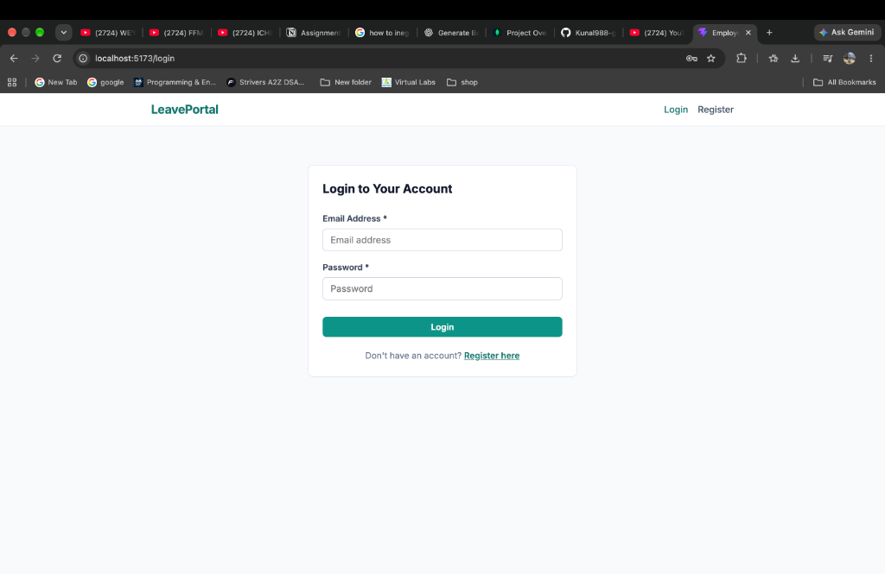
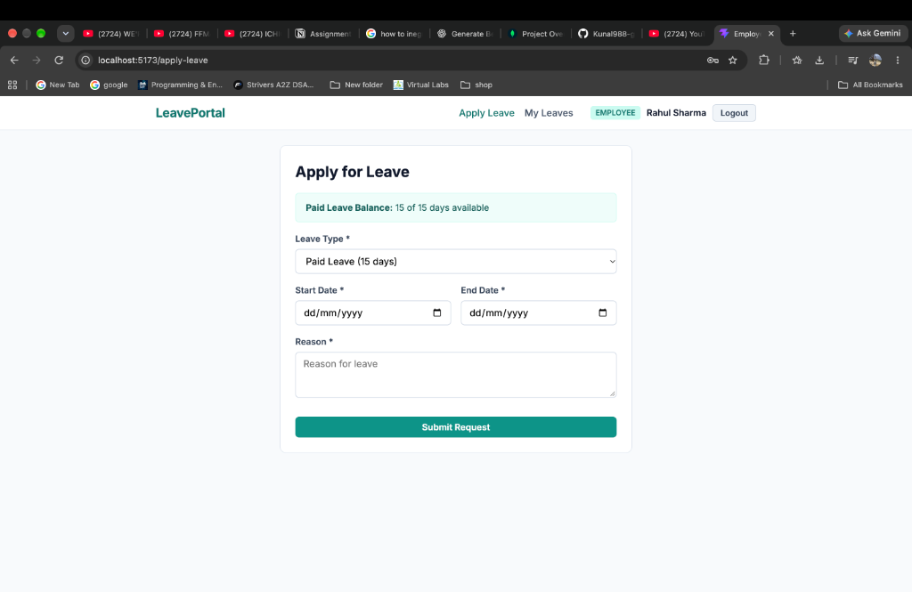
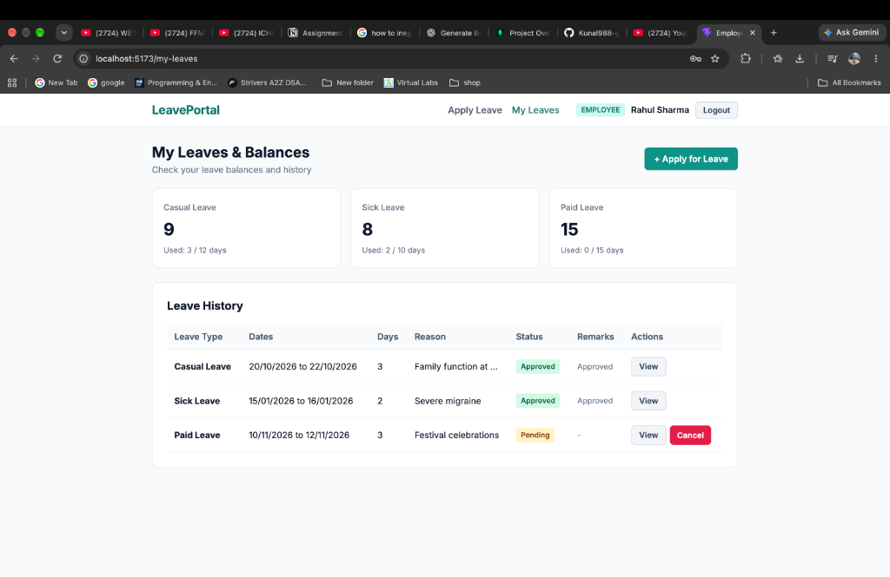
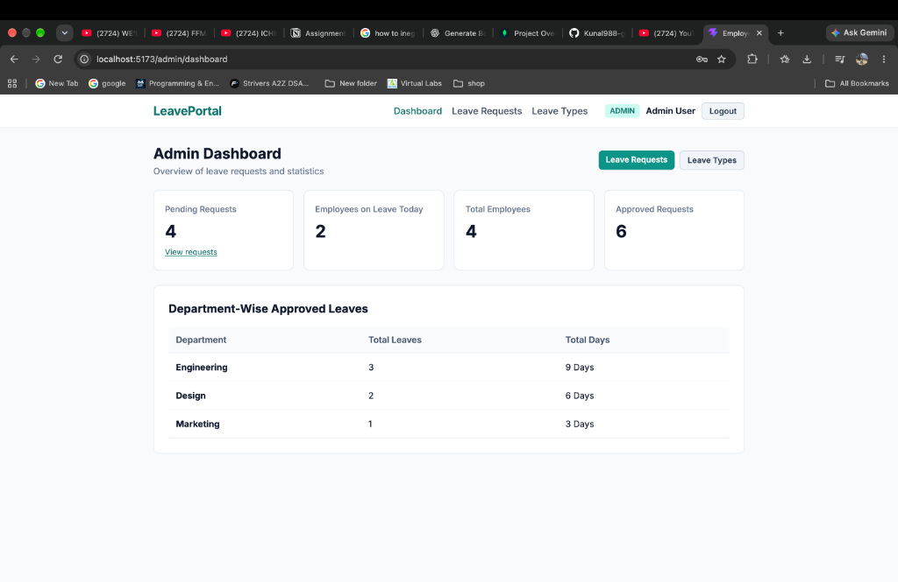
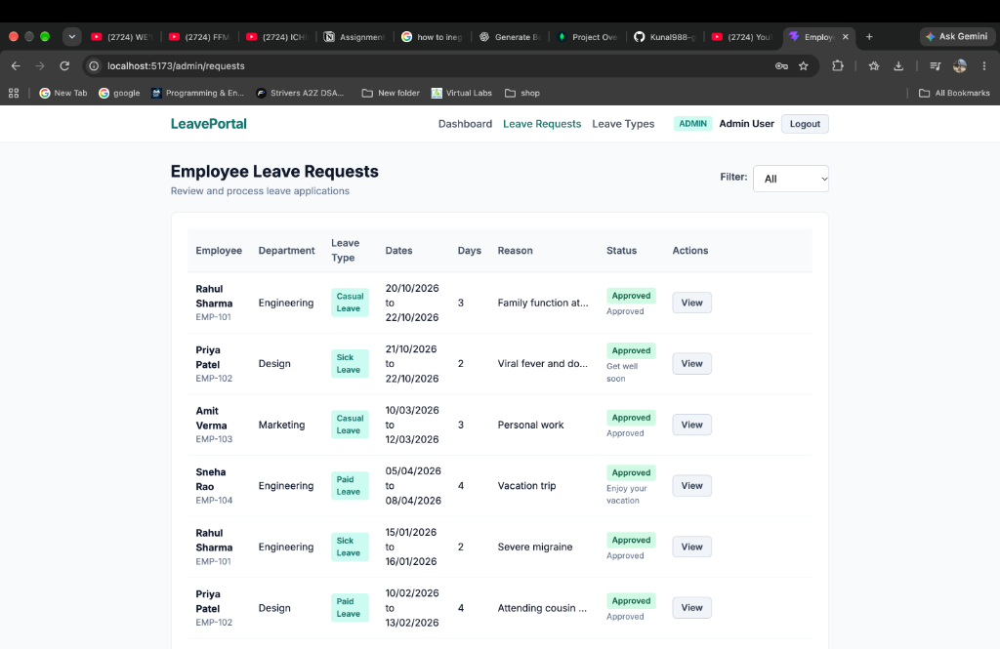

# Employee Leave Management System

A MERN stack web application for managing employee leaves and tracking leave balances.

## Problem Statement

In many small organizations and college departments, leave applications are handled manually through paper forms, emails, or chat messages. This leads to lost requests, confusion regarding remaining leave balances, overlapping leaves within the same department, and lack of central visibility for administrators.

This Employee Leave Management System automates the entire process:
- Employees can check their remaining leave quotas, apply for leave, and view request status.
- Admins can manage leave types, review and approve/reject applications with remarks, and monitor department-level leave metrics from a central dashboard.

## Live URLs

- **Frontend (Vercel):** `https://your-frontend-app.vercel.app` *(Replace with your deployed URL)*
- **Backend (Render):** `https://employee-management-06.onrender.com`

## Test Credentials

Use these seeded accounts to test the application:

| Role | Email | Password |
|---|---|---|
| **Admin** | `admin@company.com` | `Admin@12345` |
| **Employee** | `rahul@company.com` | `User@12345` |
| **Employee 2** | `priya@company.com` | `User@12345` |

*(You can also register a new employee account directly from the Register page.)*

## Features

### Employee
- User registration and login with JWT authentication
- View available leave balance for each leave type
- Apply for leave with start date, end date, and reason
- Automatic calculation of total leave days
- Checks to prevent overlapping leave requests and insufficient balance
- View leave application history with status (`pending`, `approved`, `rejected`) and admin remarks
- Cancel pending leave requests

### Admin
- Dashboard showing pending requests, employees on leave today, and department-wise counts
- Review pending applications with one-click Approve / Reject and optional remarks
- Automatic deduction of leave balance when a request is approved
- Manage leave types: add, edit, toggle active status, and delete
- Safeguard preventing deletion of leave types that already have linked requests

## Tech Stack

- **Frontend:** React (Vite), React Router, Vanilla CSS
- **Backend:** Node.js, Express.js
- **Database:** MongoDB Atlas with Mongoose
- **Authentication:** JSON Web Tokens (JWT), bcryptjs
- **Tools:** dotenv, cors

## Environment Variables

### Backend (`backend/.env`)

```env
PORT=5001
MONGO_URI=your_mongodb_atlas_connection_string
JWT_SECRET=your_jwt_secret_key
CLIENT_URL=http://localhost:5173
NODE_ENV=development
```

### Frontend (`frontend/.env`)

```env
VITE_API_URL=http://localhost:5001/api
```

## Setup and Installation

### 1. Prerequisites
- Node.js (v18+)
- MongoDB Atlas connection string

### 2. Backend Setup
```bash
cd backend
npm install
```

Create a `.env` file inside the `backend` folder and add your `MONGO_URI` and `JWT_SECRET`.

Seed the database with test users, leave types, and sample leave requests:
```bash
npm run seed
```

Start the backend server:
```bash
npm run dev
```
The server runs on `http://localhost:5001`.

### 3. Frontend Setup
In a new terminal:
```bash
cd frontend
npm install
```

Create a `.env` file inside the `frontend` folder:
```env
VITE_API_URL=http://localhost:5001/api
```

Start the frontend development server:
```bash
npm run dev
```
Open `http://localhost:5173` in your browser.

## API Endpoints

### Auth Routes (`/api/auth`)
| Method | Endpoint | Description | Access |
|---|---|---|---|
| `POST` | `/api/auth/register` | Register a new employee | Public |
| `POST` | `/api/auth/login` | Login user & get JWT token | Public |
| `GET` | `/api/auth/me` | Get logged-in user profile | Authenticated |

### Leave Routes (`/api/leaves`)
| Method | Endpoint | Description | Access |
|---|---|---|---|
| `POST` | `/api/leaves` | Submit a leave application | Employee |
| `GET` | `/api/leaves/my` | Get current user's leave history | Employee |
| `GET` | `/api/leaves/balances` | Get current user's leave balances | Employee |
| `GET` | `/api/leaves/:id` | Get details of a single leave request | Authenticated |
| `DELETE` | `/api/leaves/:id` | Cancel a pending leave request | Employee |
| `GET` | `/api/leaves` | Get all leave requests (filter by `status`) | Admin |
| `PATCH` | `/api/leaves/:id/status` | Approve or reject a leave request | Admin |

### Leave Type Routes (`/api/leave-types`)
| Method | Endpoint | Description | Access |
|---|---|---|---|
| `GET` | `/api/leave-types` | Get all active leave types | Authenticated |
| `GET` | `/api/leave-types/:id` | Get leave type by ID | Authenticated |
| `POST` | `/api/leave-types` | Create a new leave type | Admin |
| `PUT` | `/api/leave-types/:id` | Update leave type details | Admin |
| `DELETE` | `/api/leave-types/:id` | Delete an unused leave type | Admin |

### Dashboard Routes (`/api/dashboard`)
| Method | Endpoint | Description | Access |
|---|---|---|---|
| `GET` | `/api/dashboard/stats` | Get dashboard overview metrics | Admin |

## Screenshots


### 1. Login Page


### 2. Employee - Apply for Leave


### 3. Employee - My Leaves & Balances


### 4. Admin - Dashboard


### 5. Admin - Leave Requests Management


### 6. Admin - Manage Leave Types


## Deployment Notes

### Backend on Render
- **Build Command:** `npm install`
- **Start Command:** `node server.js`
- **Root Directory:** `backend`
- **Environment Variables:** `MONGO_URI`, `JWT_SECRET`, `CLIENT_URL`, `NODE_ENV=production`

### Frontend on Vercel
- **Framework Preset:** `Vite`
- **Root Directory:** `frontend`
- **Build Command:** `npm run build`
- **Output Directory:** `dist`
- **SPA Rewrites:** Handled via `frontend/vercel.json`
- **Environment Variable:** `VITE_API_URL=https://your-backend-api.onrender.com/api`
